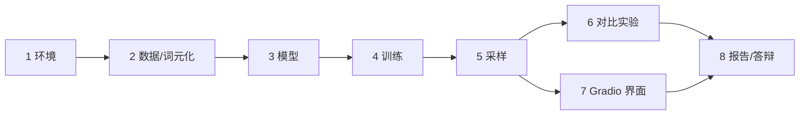

# 00 · 总路线

## 项目目标

在 RTX 5060 Ti（8GB）上，用 **SmolLM-Corpus 1B 子集（约 10 亿 token）+ TinyStories（约 5 亿 token）** 的混合英文语料，从零训练三个规模的 Decoder-only Transformer：

- **s10m**（0.01B，训练 3 亿 token）、**s50m**（0.05B，10 亿）、**s100m**（0.1B，15 亿）

用相同数据、相同随机种子、相同有效 batch 训练，token 预算按规模分配。对比两个语料上的 val loss、相同 token 数下的曲线、生成质量和训练成本；再用 Gradio 界面展示续写效果和采样参数的影响。重点是**每个组员都能讲清楚每一行核心代码**。

## 阶段与依赖

| 阶段 | 主要产物 | 预计工作量 |
|---|---|---|
| 1 环境 | `environment.yml`、`requirements.txt`、`src/check_env.py`、`.gitignore` | 0.5 天 |
| 2 数据 | `src/tokenizer.py`、`src/prepare.py`、`data/processed/*`、`docs/data.md` | 1–1.5 天 |
| 3 模型 | `src/model.py`、`tests/test_model.py` | 1–1.5 天 |
| 4 训练 | `src/train.py`、`src/utils.py`、`configs/*.yaml` | 1.5 天 |
| 5 采样 | `src/sample.py` | 0.5 天 |
| 6 实验 | 3 个正式 run、`src/plot_compare.py`、`docs/experiments.md` | 训练约 28 小时 GPU 时间（分多晚）+ 1 天分析 |
| 7 界面 | `app/app.py` | 1 天 |
| 8 报告 | `README.md`、`docs/model.md`、答辩材料 | 1 天 |

## 里程碑

| 里程碑 | 内容 | 完成标志 |
|---|---|---|
| **M1 流程跑通** | 两个数据集各 1 个分片（~0.57GB）+ debug 模型，阶段 1–5 的最小版本 | `sample.py` 能输出像样的英文片段；过拟合测试通过 |
| **M2 第一个正式模型** | 全量数据（~3.7GB）+ s10m 完整训练（~1h）+ 界面雏形 | `runs/s10m/` 有 loss 曲线，界面能生成 |
| **M3 三模型对比** | s50m（~7h）、s100m（~20h）训练完成，实验 A、B 完成 | `docs/experiments.md` 有叠图、样例表、结论 |
| **M4 交付** | README、结构图、答辩问题清单 | 新机器按 README 能复现 |

## 模型规模

词表 8192、上下文 `block_size=512`、`head_size=64`、`bias=True`、MLP 扩张 4 倍。

| 名称 | 层/维/头 | 非 embedding 参数 | 总参数（wte 共享 + wpe） | 训练 token | token/参数 | 用途 |
|---|---|---|---|---|---|---|
| debug | 4 / 256 / 4 | 3.16M | 5.39M | ~2000 万 | — | 流程验证、过拟合测试 |
| s10m | 6 / 384 / 6 | 10.65M | 13.99M | 3 亿 | ~21 | 0.01B |
| s50m | 10 / 640 / 10 | 49.24M | 54.81M | 10 亿 | ~18 | 0.05B |
| s100m | 14 / 768 / 12 | 99.23M | 105.92M | 15 亿 | ~14 | 0.1B |

计算方法：每层参数 = `12·C² + 13·C`（注意力 4C²、MLP 8C²，再加 bias 和 LayerNorm）；embedding = `8192·C`（与输出层共享，只算一次）；位置编码 = `512·C`。"非 embedding"不含 wte 和 wpe。阶段 3 用代码实际打印核对。

**token 预算按规模分配**：参照 Chinchilla 的经验（计算最优时约 20 token/参数），小模型少训、大模型多训，每个模型都接近"计算最优"。代价是三个模型最终看过的数据量不同，所以对比时除了最终 loss，还要看**相同已训练 token 数**下的 loss（s50m、s100m 在 3 亿 token 处的 checkpoint 与 s10m 最终结果比较）。

## 资源估算（冒烟测试后用实测 tok/s 校准）

**显存**：参数 fp32 + 梯度 + AdamW 两个状态 ≈ 16 字节/参数 → s100m 约 1.6GB；bf16 + SDPA 下 micro-batch 16×512 的激活约 3GB。8GB 够用，不够时按 CLAUDE.md 顺序处理。

**吞吐**：每个 token 的训练计算量 ≈ `6N + 12·L·T·C` FLOPs（N 为参数量）。按有效算力约 15 TFLOPS：

| 模型 | FLOPs/token | 预计 tok/s | 训练 token | 预计用时 |
|---|---|---|---|---|
| s10m | ~98M | ~100k（小模型 GPU 利用率低） | 3 亿 | ~1 小时 |
| s50m | ~368M | ~41k | 10 亿 | ~7 小时 |
| s100m | ~701M | ~21k | 15 亿 | ~20 小时 |

合计约 28 小时 GPU 时间，s50m、s100m 需要靠断点续训分几个晚上跑完。每次正式训练前都先报告配置、预计时长和显存，征得同意再跑。

**数据与磁盘**：下载约 3.7GB（SmolLM 2.67GB + TinyStories 约 1GB），编码后 bin 约 3–3.5GB，磁盘至少留 12GB。数据集作者统计的"10 亿 token"用的是别的分词器，我们的 8k BPE 下实际 token 数以 `prepare.py` 的统计为准；如果全量明显超过 15 亿，s100m 不到一轮，结论不受影响。

## 交付物对照表

| 要求（TARGET.md / CLAUDE.md） | 对应阶段 | 产物 |
|---|---|---|
| 准备数据集，预处理与词元化 | 2 | `src/prepare.py`、`src/tokenizer.py`、`docs/data.md` |
| 从零实现 Decoder-only Transformer | 3 | `src/model.py` |
| next-token prediction 训练，记录 loss 曲线 | 4 | `src/train.py`、`runs/*/log.csv`、`loss_curve.png` |
| 交互界面：输入 prompt、调长度和温度、选 checkpoint | 5、7 | `src/sample.py`、`app/app.py` |
| 至少比较两种训练设置或采样参数 | 6 | 实验 A（模型规模，分来源 val loss）+ 实验 B（采样参数） |
| 说明数据来源、模型结构、训练设置 | 2、3、4、8 | `docs/data.md`、`docs/model.md`、配置副本 |
| 模型结构图和参数量统计 | 3、8 | `docs/model.md` |
| README：如何复现 | 8 | 根目录 `README.md` |

## 分工建议（3 人组）

| 角色 | 负责阶段 | 答辩时主讲 |
|---|---|---|
| A 数据 + 采样 | 2、5 | BPE 原理、数据清洗、temperature/top-k |
| B 模型 + 训练 | 3、4 | 注意力、因果掩码、损失函数、学习率调度 |
| C 实验 + 界面 + 报告 | 6、7、8 | 规模对比结论、界面演示 |

阶段 1 一起做。每个阶段完成后由**另一位组员**按"验收标准"复核并互讲一遍代码，保证人人都能回答"答辩可能被问的问题"。
