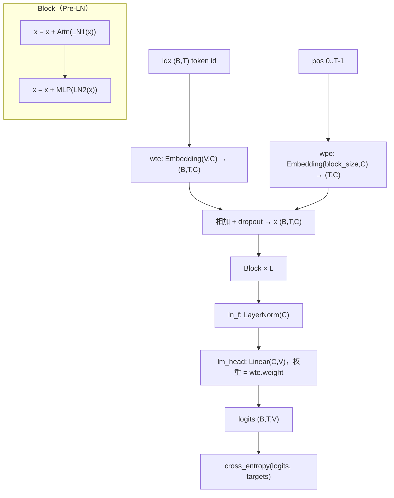

# 阶段 3 · 模型（手写 GPT）

## 目标

在 `src/model.py` 手写一个 GPT 风格的 Decoder-only Transformer，四档配置（debug / s10m / s50m / s100m）都能正确构建，通过形状、因果性、数值和过拟合测试。

**不能**使用 HuggingFace 的 `GPT2LMHeadModel` 等现成模型；可以用 `nn.Linear`、`nn.Embedding`、`nn.LayerNorm`、`F.scaled_dot_product_attention`。

## 前置条件

- 阶段 1 环境；阶段 2 的 `meta.json`（提供 `vocab_size`）。模型本身的单元测试可以用随机 token，不依赖真实数据。

## 结构总览



## 要写的文件与函数签名

```python
# src/model.py
@dataclass
class GPTConfig:
    vocab_size: int = 8192
    block_size: int = 512        # 最大上下文长度 T
    n_layer: int = 6             # L
    n_head: int = 6              # nh
    n_embd: int = 384            # C；head_size hs = C // nh
    dropout: float = 0.0
    bias: bool = True
    grad_ckpt: bool = False      # 梯度检查点（显存不够时开）
    manual_attn: bool = False    # True 时用手写注意力（教学/对比），False 用 SDPA

class CausalSelfAttention(nn.Module):
    def __init__(self, cfg: GPTConfig) -> None: ...
    def forward(self, x: torch.Tensor) -> torch.Tensor: ...          # (B,T,C) -> (B,T,C)

class MLP(nn.Module):
    def forward(self, x: torch.Tensor) -> torch.Tensor: ...          # C -> 4C -> GELU -> C

class Block(nn.Module):
    def forward(self, x: torch.Tensor) -> torch.Tensor: ...

class GPT(nn.Module):
    def __init__(self, cfg: GPTConfig) -> None: ...
    def forward(self, idx: torch.Tensor, targets: torch.Tensor | None = None
                ) -> tuple[torch.Tensor, torch.Tensor | None]: ...   # logits, loss
    def num_params(self, non_embedding: bool = True) -> int: ...
    def configure_optimizers(self, weight_decay: float, lr: float,
                             betas: tuple[float, float]) -> torch.optim.AdamW: ...

MODEL_PRESETS: dict[str, dict] = {
    "debug": dict(n_layer=4,  n_embd=256, n_head=4),
    "s10m":  dict(n_layer=6,  n_embd=384, n_head=6),
    "s50m":  dict(n_layer=10, n_embd=640, n_head=10),
    "s100m": dict(n_layer=14, n_embd=768, n_head=12),
}
```

## 实现要点

### 1. 嵌入

- `wte = nn.Embedding(V, C)`：token id → 向量。
- `wpe = nn.Embedding(block_size, C)`：可学习的绝对位置编码。注意力本身对顺序不敏感（打乱输入顺序，输出只是跟着打乱），必须显式告诉模型"第几个位置"。
- `x = dropout(wte(idx) + wpe(pos))`，形状 `(B,T,C)`；`pos` 形状 `(T,)` 广播到 batch。

### 2. 因果自注意力（核心，必须能逐行讲）

```text
x:  (B, T, C)
qkv = c_attn(x)                         # Linear(C, 3C) → (B, T, 3C)
q, k, v = qkv.split(C, dim=2)           # 各 (B, T, C)
q = q.view(B, T, nh, hs).transpose(1, 2)    # (B, T, C) -> (B, nh, T, hs)
k, v 同理
```

- **手写版本**（`manual_attn=True`）：

```text
att = q @ k.transpose(-2, -1) / sqrt(hs)    # (B, nh, T, T)  第 i 行 = 位置 i 对所有位置的打分
att = att.masked_fill(mask[:T,:T] == 0, -inf)   # 因果掩码：位置 i 只能看 j ≤ i
att = softmax(att, dim=-1)                  # 每行变成概率分布
y = att @ v                                 # (B, nh, T, hs)
```

- **SDPA 版本**（默认）：`y = F.scaled_dot_product_attention(q, k, v, is_causal=True, dropout_p=...)`，数学上等价，但会自动选 FlashAttention 内核，不显式构造 T×T 矩阵，省显存、更快。
- 合并多头：`y.transpose(1, 2).contiguous().view(B, T, C)` → `c_proj: Linear(C, C)` → dropout。
- 为什么除以 `sqrt(hs)`：点积的方差随维度增长，不缩放会让 softmax 过尖、梯度消失。
- 为什么要因果掩码：训练时一次喂入整句，并行预测每个位置的下一个 token；如果位置 i 能看到 i+1，就等于"偷看答案"，生成时却没有未来信息，训练和推理就不一致了。
- 为什么多头：每个头在 `hs=64` 维子空间里独立算注意力，可以同时关注不同关系（如语法搭配、指代）。

### 3. MLP 与 Block

- `MLP`: `Linear(C,4C) → GELU → Linear(4C,C) → dropout`。注意力负责"在位置之间交换信息"，MLP 负责"在每个位置上独立做非线性变换"。
- **Pre-LN**：`x = x + attn(ln1(x)); x = x + mlp(ln2(x))`。残差连接让梯度能直接流回浅层；LayerNorm 放在子层前面（而不是原论文的后面）训练更稳定，深层也不容易发散。

### 4. 输出层与损失

- `ln_f` 后接 `lm_head = nn.Linear(C, V, bias=False)`，并设 `self.lm_head.weight = self.wte.weight`（**权重共享**）：输入时"id→向量"和输出时"向量→每个 id 的打分"用同一张表，省掉 `V×C` 个参数，并且通常效果更好。
- 训练：`loss = F.cross_entropy(logits.view(-1, V), targets.view(-1))`。cross entropy = 正确 token 的负对数概率（NLL）的平均，最小化它等价于最大化训练数据的似然。`exp(loss)` 就是困惑度（perplexity）。
- 推理（`targets is None`）：只算最后一个位置的 logits `x[:, [-1], :]`，省计算。

### 5. 初始化

- 所有 `Linear`/`Embedding` 权重 `normal(0, 0.02)`，bias 置 0。
- 每个残差分支的输出投影（`attn.c_proj`、`mlp.c_proj`）用 `std = 0.02 / sqrt(2 * n_layer)`：残差流上叠加了 2L 个分支，缩小每个分支的初始幅度，防止深层模型初始输出方差爆炸。

### 6. 参数统计与优化器分组

- `num_params(non_embedding=True)`：减去 `wte` 和 `wpe` 的参数（`lm_head` 与 `wte` 共享，不重复计）。
- `configure_optimizers`：二维及以上的权重（Linear、Embedding）做 weight decay；bias 和 LayerNorm 参数**不**做 decay。CUDA 上用 `fused=True` 的 AdamW 加速。

### 7. 梯度检查点（可选）

`grad_ckpt=True` 时，每个 Block 用 `torch.utils.checkpoint.checkpoint(block, x, use_reentrant=False)`：前向时不保存中间激活，反向时重算一遍，用约 30% 的额外计算换大幅降低的激活显存。

## 验收标准

```bash
python src/model.py      # __main__ 里打印四档配置的参数量
pytest tests/test_model.py
```

1. **参数量**（与 roadmap 表一致，s100m 不得超过 1.1 亿）：

| 名称 | 非 embedding | 总参数（V=8192） |
|---|---|---|
| debug | 3.16M | 5.39M |
| s10m | 10.65M | 13.99M |
| s50m | 49.24M | 54.81M |
| s100m | 99.23M | 105.92M |

2. **形状**：输入 `(2, 16)`，logits `(2, 16, 8192)`；推理模式 logits `(2, 1, 8192)`。
3. **初始 loss**：随机初始化、随机 token 上 loss ≈ `ln(8192) ≈ 9.01`（±0.3）。明显偏高说明初始化有问题。
4. **注意力等价**：同一权重下 `manual_attn=True/False` 的输出 `torch.allclose(atol=1e-5)`（fp32、dropout=0）。
5. **因果性**：随机修改位置 t 之后的 token，位置 0..t 的 logits 完全不变。
6. **权重共享**：`model.lm_head.weight is model.wte.weight` 为 True。
7. **过拟合测试**（CLAUDE.md 要求，每次改结构都要跑）：debug 配置，固定一个 `(4, 64)` 的 batch，AdamW lr=1e-3 训练 200 步，loss < 0.1。

## 常见坑

- `view` 前忘 `.contiguous()` 报错。
- 权重共享写成了 `self.wte.weight = self.lm_head.weight` 后又被初始化函数覆盖——共享后检查两者 `data_ptr()` 相同。
- `masked_fill` 用的掩码要注册为 `register_buffer`，否则不会跟着 `.to(device)` 走。
- 用 SDPA 时既传 `attn_mask` 又传 `is_causal=True` 会报错，二选一。
- 训练时 `T` 可以小于 `block_size`，位置 `pos = torch.arange(T)` 不要写死成 `block_size`。

## 答辩可能被问的问题

- 为什么叫 Decoder-only？与原始 Transformer 的 Encoder-Decoder 有什么区别？
- 把 `(B,T,C)` 变成 `(B,nh,T,hs)` 的每一步在做什么？
- 去掉因果掩码会发生什么？（训练 loss 会降得极低，但生成完全不行）
- 为什么除以 √d？为什么用 LayerNorm？Pre-LN 和 Post-LN 区别？
- 权重共享省了多少参数？为什么合理？
- 为什么 loss 用 cross entropy？初始 loss 为什么约等于 ln(V)？
- 参数量怎么算？每层为什么约 12C²？
