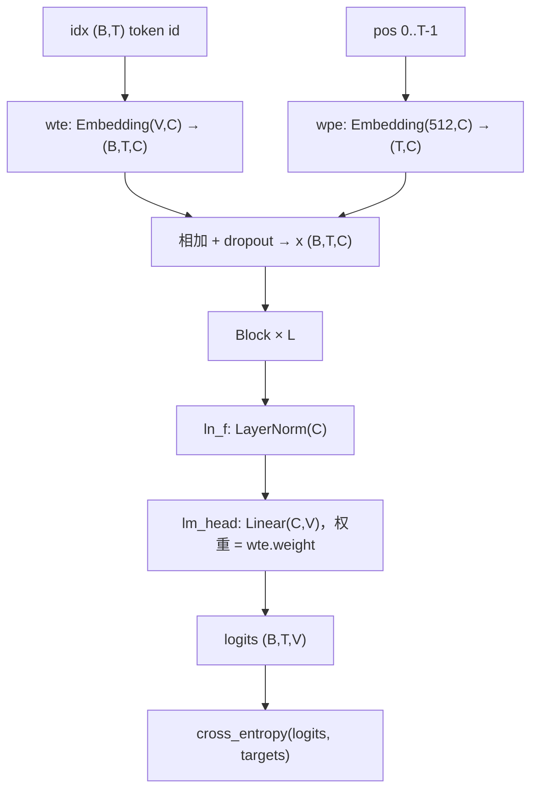
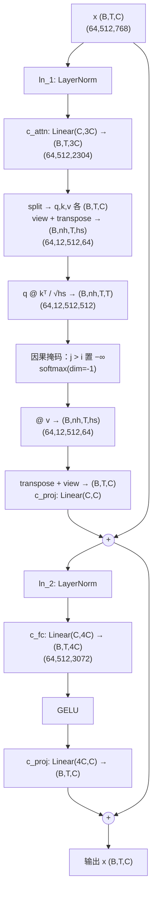

# 模型结构、参数量与训练设置

实现：[`src/model.py`](../src/model.py)（手写，只用 `nn.Linear`、`nn.Embedding`、`nn.LayerNorm` 和 `F.scaled_dot_product_attention`）。设计说明见 [03-model.md](03-model.md)。

记号：B = batch，T = 序列长度（≤ 512），C = `n_embd`，nh = `n_head`，hs = C / nh = 64，V = 8192，L = `n_layer`。

## 1. 整体结构

GPT 风格的 Decoder-only Transformer：token embedding + 可学习位置编码 → L 个 Pre-LN Block → 最后的 LayerNorm → 输出层（与 token embedding 共享权重）。

## 2. 单个 Block 内部的张量形状

括号里是 s100m 的具体数值（B 取 micro-batch 64，C=768，nh=12，hs=64，T=512）。

- 实际训练用 SDPA（`is_causal=True`），不显式构造 `(B,nh,T,T)` 的矩阵，走 FlashAttention 内核；`manual_attn=True` 时走上图的手写路径，两者输出在测试里 `allclose`。
- 上图的 `(B,nh,T,T)` 在 s100m 下是 64×12×512×512 ≈ 2 亿个数，bf16 下 0.4GB/层——这就是 SDPA 能省显存的原因。

## 3. 参数量统计

由 `python src/model.py` 打印（meta 设备上实际构建模型后统计 `named_parameters()`，不是公式估算）：

| 组件 | 公式 | debug | s10m | s50m | s100m |
|---|---|---|---|---|---|
| wte（与 lm_head 共享） | V·C | 2,097,152 | 3,145,728 | 5,242,880 | 6,291,456 |
| wpe | 512·C | 131,072 | 196,608 | 327,680 | 393,216 |
| 每层 attn（c_attn + c_proj） | 4C² + 4C | 263,168 | 591,360 | 1,640,960 | 2,362,368 |
| 每层 mlp（c_fc + c_proj） | 8C² + 5C | 525,568 | 1,181,568 | 3,280,000 | 4,722,432 |
| 每层 LN（ln_1 + ln_2） | 4C | 1,024 | 1,536 | 2,560 | 3,072 |
| **每层合计** | 12C² + 13C | 789,760 | 1,774,464 | 4,923,520 | 7,087,872 |
| × 层数 L | | ×4 = 3,159,040 | ×6 = 10,646,784 | ×10 = 49,235,200 | ×14 = 99,230,208 |
| ln_f | 2C | 512 | 768 | 1,280 | 1,536 |
| **总计** | | **5,387,776** | **13,989,888** | **54,807,040** | **105,916,416** |
| 非 embedding（不含 wte、wpe） | | 3.16M | 10.65M | 49.24M | 99.23M |

要点：

- **每层约 12C²**：注意力 4 个 C×C 矩阵（q、k、v、输出投影），MLP 两个 C×4C 矩阵 = 8C²。
- **权重共享**省掉了一个 V×C 的输出层：s100m 省 629 万参数，s10m 省 315 万（占 s10m 总参数的 22%）。
- **词表小的好处**：如果用 GPT-2 的 50257 词表，s10m 的 embedding 就是 1930 万，比整个模型的其余部分还大。
- 全部低于 0.11B 的上限。

## 4. 训练设置

四个配置（`configs/*.yaml`）只有**结构、micro-batch × 梯度累积、学习率、步数**不同，其余完全相同：

| 超参数 | debug | s10m | s50m | s100m |
|---|---|---|---|---|
| 结构（层/维/头） | 4 / 256 / 4 | 6 / 384 / 6 | 10 / 640 / 10 | 14 / 768 / 12 |
| 词表 / 上下文 / head_size | 8192 / 512 / 64 | 同左 | 同左 | 同左 |
| dropout / bias | 0.0 / True | 同左 | 同左 | 同左 |
| micro-batch × 累积（5090） | 32 × 1 | 128 × 2 | 64 × 4 | 64 × 4 |
| 本地 8GB 显卡 | 32 × 1 | 64 × 4 | 32 × 8 | 16 × 16 |
| 有效 batch（token/步） | 16,384 | 131,072 | 131,072 | 131,072 |
| 峰值 lr → min_lr | 1e-3 → 1e-4 | 1e-3 → 1e-4 | 6e-4 → 6e-5 | 4e-4 → 4e-5 |
| 总步数 | 1,200 | 2,290 | 7,630 | 11,450 |
| 训练 token | 0.02B | 0.30B | 1.00B | 1.50B |
| warmup | 200 步线性 | 同左 | 同左 | 同左 |
| 学习率调度 | cosine 衰减到 lr/10 | 同左 | 同左 | 同左 |
| 优化器 | AdamW，β=(0.9, 0.95)，weight decay 0.1（只对二维权重） | 同左 | 同左 | 同左 |
| 梯度裁剪 | 全局范数 1.0 | 同左 | 同左 | 同左 |
| 精度 | bf16 autocast（不需要 GradScaler） | 同左 | 同左 | 同左 |
| 数据混合 | 自然比例 SmolLM 70.3% : TinyStories 29.7% | 同左 | 同左 | 同左 |
| 评估 | 每 200 步，每来源 50 个 batch | 同左 | 同左 | 同左 |
| 随机种子 | 1337 | 同左 | 同左 | 同左 |
| torch.compile | 开 | 开 | 开 | 开 |

实测资源（云端 RTX 5090，只算训练步）：

| 模型 | 平均吞吐 | 显存峰值 | 训练时长 | 训练计算量 6·N·D |
|---|---|---|---|---|
| s10m | 1117k tok/s | 9.2 GB | 4.6 min | 2.5e16 FLOPs |
| s50m | 370k tok/s | 10.4 GB | 45.2 min | 3.3e17 FLOPs |
| s100m | 216k tok/s | 16.5 GB | 115.9 min | 9.5e17 FLOPs |

为什么大模型学习率更小：参数越多、层越深，同样的学习率下每一步对输出的扰动越大，容易不稳定；经验上峰值 lr 随宽度增大而减小（nanoGPT 的 124M 用 6e-4）。

## 5. 代码位置索引

| 内容 | 位置 |
|---|---|
| 配置与四档预设 | `src/model.py:23`（`GPTConfig`）、`src/model.py:36`（`MODEL_PRESETS`） |
| 多头拆分 `(B,T,C)→(B,nh,T,hs)` | `src/model.py:70-74` |
| 手写注意力：缩放、因果掩码、softmax | `src/model.py:80-85` |
| SDPA 注意力 | `src/model.py:88-90` |
| 合并多头 + 输出投影 | `src/model.py:94-95` |
| MLP / Pre-LN Block / 残差 | `src/model.py:98-127` |
| 权重共享 | `src/model.py:142` |
| 残差分支缩小初始化 | `src/model.py:146-150` |
| cross entropy 损失 | `src/model.py:184` |
| 参数量统计 | `src/model.py:190`（`num_params`）、`src/model.py:216`（`param_breakdown`） |
| AdamW 分组（哪些参数做 weight decay） | `src/model.py:198` |
| warmup + cosine | `src/utils.py:110`（`get_lr`） |
| 梯度累积 / 裁剪 | `src/train.py:225-237` |
